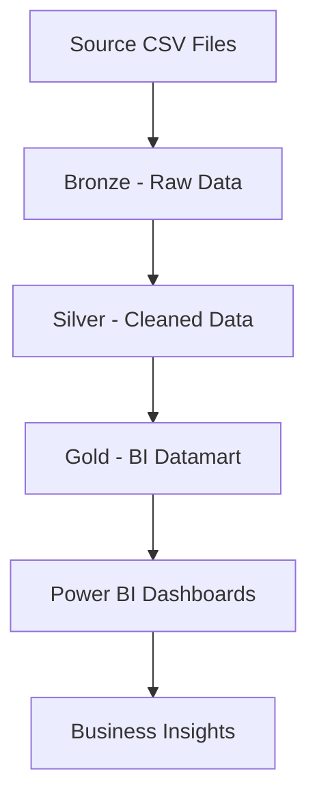

# digital-payments-bi-analytics
End-to-end digital payments business intelligence project using SQL Server, Python, ETL pipelines and Power BI, inspired by Southeast Asian fintech operations.
# Digital Payments Business Intelligence & Transaction Analytics

## Project Overview

An end-to-end business intelligence portfolio project inspired by digital payments and fintech operations in Southeast Asia.

The project simulates the responsibilities of a regional Business Intelligence Analyst, including data engineering, ETL development, financial reconciliation, advanced SQL analysis, performance monitoring and dashboard development.

All datasets are synthetic. This is an independent portfolio project and is not affiliated with ShopeePay or Monee.

## Business Objectives

- Monitor transaction performance across six Southeast Asian markets.
- Identify payment failures and operational bottlenecks.
- Analyse payment value and fee revenue growth.
- Investigate customer engagement and retention.
- Evaluate merchant and payment method performance.
- Develop actionable, data-driven business recommendations.

## Technology Stack

| Technology | Application |
|---|---|
| Python | Synthetic data generation |
| SQL Server Express | Database management |
| T-SQL | ETL, transformation and analytics |
| SSMS | Database development and testing |
| Power BI | Planned reporting and visualisation |
| DAX | Planned business KPI calculations |
| GitHub | Version control and documentation |

## Dataset

The simulated dataset contains 58,350 source records.

| Dataset | Records |
|---|---:|
| Payment transactions | 50,000 |
| Customers | 8,000 |
| Merchants | 350 |
| Regional markets | 6 |

Markets covered:

Singapore, Malaysia, Indonesia, Thailand, Vietnam and the Philippines.

## Data Architecture

The project adopts a simplified medallion architecture.

### Bronze Layer

- Imported source CSV datasets into SQL Server.
- Preserved original source records.
- Implemented initial ingestion validation.

### Silver Layer

- Developed a reusable T-SQL ETL stored procedure.
- Converted raw data into appropriate SQL data types.
- Standardised categorical values and text fields.
- Implemented primary and foreign key constraints.
- Enforced financial business rules.
- Incorporated transaction management and error handling.
- Validated record counts and financial totals.

### Gold Layer

Planned development of a business-ready star schema consisting of:

- Transaction fact table
- Customer dimension
- Merchant dimension
- Calendar dimension
- Analytical reporting views

## Data Quality Assessment

All 12 consolidated data quality checks returned zero detected issues.

| Quality Check | Issues |
|---|---:|
| Duplicate customer IDs | 0 |
| Duplicate merchant IDs | 0 |
| Duplicate transaction IDs | 0 |
| Invalid transaction dates | 0 |
| Invalid signup dates | 0 |
| Invalid transaction amounts | 0 |
| Invalid fee amounts | 0 |
| Non-positive transaction amounts | 0 |
| Negative fee amounts | 0 |
| Unmatched customer IDs | 0 |
| Unmatched merchant IDs | 0 |
| Invalid transaction statuses | 0 |

## Financial Reconciliation

Validated monetary totals between the Bronze and Silver layers.

| Metric | Bronze | Silver | Difference |
|---|---:|---:|---:|
| Attempted transaction value | S$2,293,357.67 | S$2,293,357.67 | S$0.00 |
| Fee revenue | S$17,535.44 | S$17,535.44 | S$0.00 |

All 58,350 source records were preserved during the ETL process.

## Preliminary Business KPIs

| KPI | Result |
|---|---:|
| Total payment attempts | 50,000 |
| Successful transactions | 47,741 |
| Failed transactions | 1,740 |
| Pending transactions | 519 |
| Payment success rate | 95.48% |
| Payment failure rate | 3.48% |
| Pending transaction rate | 1.04% |
| Total fee revenue | S$17,535.44 |

### Preliminary Business Insight

A total of 2,259 payment attempts were unsuccessful or pending, representing approximately 4.52% of all payment attempts.

Further analysis will investigate whether these outcomes are concentrated in specific payment methods, markets or merchant categories and evaluate potential revenue improvement opportunities.

## SQL Skills Demonstrated

- Database and schema design
- DDL and DML
- BULK INSERT
- Data cleaning and transformation
- INNER JOIN and LEFT JOIN
- GROUP BY and HAVING
- Conditional aggregation
- Common Table Expressions (CTEs)
- Stored procedures
- Primary and foreign key constraints
- Transaction management
- TRY...CATCH error handling
- Financial reconciliation

## Planned Power BI Dashboards

1. Executive Performance Overview
2. Payment Reliability and Failure Analysis
3. Customer Engagement and Retention
4. Merchant and Regional Market Performance

## Project Roadmap

- [x] Business understanding
- [x] Synthetic dataset generation
- [x] SQL Server database setup
- [x] Bronze layer ingestion
- [x] Data quality assessment
- [x] Silver layer ETL development
- [x] Financial reconciliation
- [ ] ETL repeatability and performance testing
- [ ] Gold layer BI datamart
- [ ] Advanced SQL business analysis
- [ ] Power BI data modelling
- [ ] DAX measures and dashboard development
- [ ] Business recommendations
- [ ] Final project documentation

## Author

Gift Kimbini Mushariwa

MSc Data-Driven Marketing (Data Science for Marketing)

- [LinkedIn](https://linkedin.com/in/gift-k-mush)
- [GitHub](https://github.com/Mushariwa-GK)

## Disclaimer

This project uses entirely synthetic data for educational and portfolio purposes. All financial metrics are simulated and do not represent actual ShopeePay business performance.
